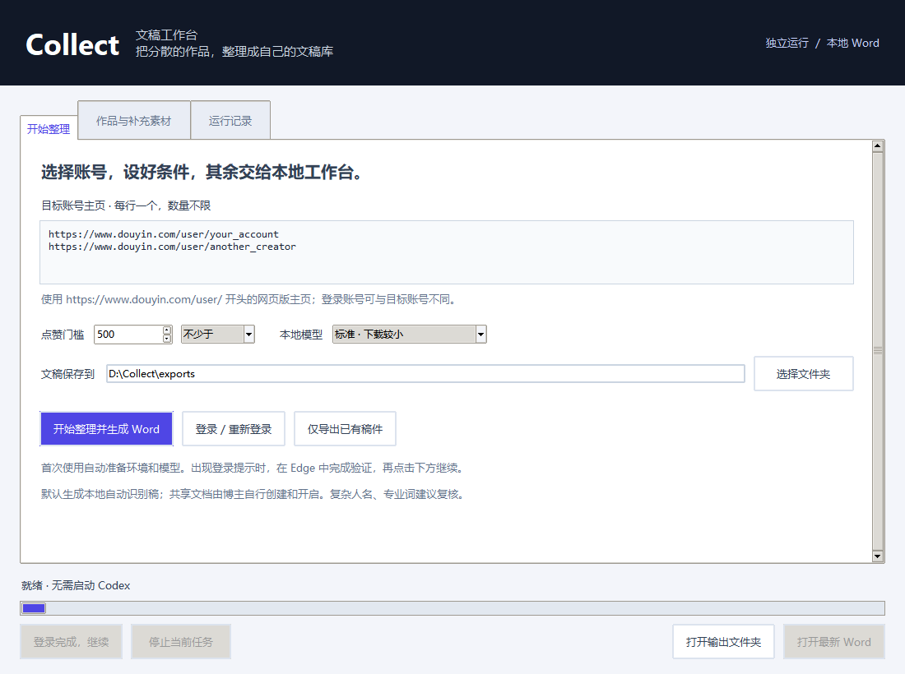

# Collect · 文稿工作台

### 把分散的视频，整理成自己的文稿资产。

为内容创作者设计的本地整理工具：选择目标账号，设定点赞门槛，将达标作品整理为按账号分区的 Word 文稿库。

**独立桌面运行 · 自定义账号与门槛 · 本地 Word 导出 · 可选 Codex 深度校对**

[下载完整项目](https://github.com/evelyn07lg-hub/douyin-collect-skill/archive/refs/heads/main.zip) · [三步开始](#三步开始) · [常见问题](#常见问题) · [进阶配置](.agents/skills/collect/references/advanced.md)



*真实桌面界面；截图中的账号链接和保存目录为演示数据。*

---

## 从账号到文稿，只需一条清晰的工作流

**输入主页 → 设置门槛 → 完成本人登录 → 整理与识别 → 打开 Word**

Collect 把账号筛选、作品记录、素材状态和文稿排版放在同一个工作台里。你不用先建金山文档，也不用打开 Codex。已经整理过的内容可以重新导出；缺少素材的作品会留在列表中，方便补充后继续处理。

| 你想完成的事 | 工作台如何帮助你 |
| --- | --- |
| 整理自己的创作存档 | 可配置多个账号，文稿按账号分区 |
| 筛选达到指定热度的作品 | 门槛由你输入，支持“不少于”和“严格超过” |
| 将作品沉淀为可复用的文字 | 本地口播识别、图文素材处理及完整发布文案整理 |
| 拿到能直接阅读的文稿 | 自动生成 `.docx`，按账号分页、按篇留出间距 |
| 处理未能直接获取的素材 | 查看具体状态，为选中作品关联自己的原视频 |
| 保留已经修改好的版本 | 新一轮生成新文件，拒绝覆盖同名导出文件 |
| 需要更细的语义校对 | 可选在 Codex 中结合字幕、口播和自己的素材库复核 |

## 三步开始

### 1. 准备环境

推荐在 Windows 使用，安装 **Python 3.12（已验证版本）** 和 **Microsoft Edge**。Python 安装时保留 Tcl/Tk 组件，并勾选添加到 PATH。

下载上面的完整项目 ZIP，解压到一个固定文件夹。请保留完整目录，便于存放本地配置、模型和整理记录。

### 2. 双击打开工作台

双击 **`start.cmd`**，填写目标账号的抖音网页版主页链接，每行一个，再选择：

- 点赞门槛与比较方式：例如“不少于 500”或“严格超过 1000”。
- 本地模型：标准模式下载较小；精细模式使用 `large-v3-turbo`，更偏重识别质量。
- Word 保存文件夹。

点击 **「开始整理并生成 Word」**。首次会自动创建独立 Python 环境、安装依赖并下载所选模型；需要联网，首次准备与长视频识别可能耗时较长。进度和具体信息可在「运行记录」查看。

### 3. 完成登录，打开成果

首次使用时，在弹出的 Edge 中自行登录或完成验证，回到工作台点击 **「登录完成，继续」**。登录账号可以和目标账号不同；程序不索取密码。

生成成功后，点击 **「打开最新 Word」** 或 **「打开输出文件夹」**。后续会复用本地登录状态；会话失效时可点击「登录 / 重新登录」。

> **无需 Codex、ChatGPT 账号或 AI API Key 即可运行独立桌面流程。** 本地自动识别稿适合先整理再复核；复杂人名、专业词和字幕中的原有错字仍建议检查。

## 你拿到的文稿是什么样的

默认输出到 `exports/`，也可自选文件夹。每次成功导出会生成 Word 和一份整理记录：

```text
口播文稿_日期_时间.docx
整理记录_日期_时间.json
```

Word 默认包含账号分区和完整正文：账号标题宋体四号、独立起页；其他文字宋体五号；每篇记录发布时间、点赞、评论、收藏和分享，换行写类型、标题及正文。篇间留出一行，正文自然段连续排版。

统计暂未获取时显示「待获取」；没有完整且达标的正文时，只生成待处理清单，不用空文档充当成功结果。

### 遇到待处理作品

在「作品与补充素材」查看原因：

| 状态 | 下一步 |
| --- | --- |
| 需要原视频 | 选中作品，点击「为选中作品关联原视频」，选择你有权使用的对应文件 |
| 需要字幕画面 | 补充带画面的原视频；只有音轨无法核对视频字幕 |
| 待重试 | 查看运行记录，处理具体原因后重试 |
| 可导出 / 已导出 Word | 使用「仅导出已有稿件」，无需重新登录或采集 |
| 疑似重复、需要核对 | 先核对来源及已有稿件，避免重复收录或覆盖校订 |

关联原视频后，工作台会继续识别和导出；不会自动覆盖已收录、已导出或已有校订的稿件。确认没有口播的作品可以按完整发布文案整理，不能把媒体获取失败当作“无口播”。

## 三种使用方式，同一套本地数据

| 方式 | 适合谁 | 是否需要 Codex |
| --- | --- | --- |
| **独立桌面工作台** | 希望填好条件、点击运行、查看状态的创作者 | 不需要 |
| **命令行工具** | 希望批量运行、集成现有流程的用户 | 不需要 |
| **Collect Skill** | 希望通过自然语言操作并进一步做语义校对的用户 | 需要自己的 Codex 环境 |

独立桌面使用本地识别模型。视频字幕融合、素材库与标点模型属于可选进阶配置，需要对应素材和模型；启用后保留原始识别与对齐依据。在 Codex 中还可以按“用户确认词语 → 作者字幕 → 实际口播 → 匹配素材库”复核，不能用参考稿补入视频没有说过的内容。

**直接识别、字幕融合与人工或 AI 深度复核是不同阶段，导出成功不代表已经逐字听审。**

## 金山共享文档，由你自己开启

**没有共享文档，也能直接使用 Collect 生成本地 Word。**

如果希望分享给别人，由博主自行创建或上传金山文档，并自己开启共享、选择访问权限。Collect 不会替你自动公开文档。

需要持续向已有共享文稿追加时，再显式配置你自己的链接与准确标题，完成登录、权限核验、备份和测试副本验证。默认桌面流程只生成本地 Word，云端追加是独立的可选路径。详见 [共享与进阶配置](.agents/skills/collect/references/advanced.md)。

## 常见问题

<details>
<summary><strong>可以完全脱离 Codex 使用吗？</strong></summary>

可以。双击 `start.cmd` 打开的是独立 Python 桌面程序，安装、账号配置、浏览器登录、采集、识别和 Word 导出均由本地程序执行。Codex Skill 是可选的另一种操作与校对入口。

</details>

<details>
<summary><strong>能保证一次抓全所有历史作品吗？</strong></summary>

采集受平台页面、登录状态和访问限制影响。默认执行有预算的一轮，历史扫描出现 partial/stalled 代表覆盖尚未完成；不等于所有作品都已查过。拒绝访问、验证码或媒体受限时，需要用户验证或补充自己的原视频，程序不会绕过限制，也不会编造逐字稿。高级用户可以调整扫描预算并继续历史核验。

</details>

<details>
<summary><strong>会自动在后台每隔几天更新吗？</strong></summary>

新安装默认不启用定时任务。希望定时运行时，需要单独配置 Windows 任务计划程序并核验实际运行结果。电脑关闭、登录失效或访问验证都可能中断更新；仅安装 Skill 不会生成常驻后台进程。

</details>

<details>
<summary><strong>我的账号、文稿和浏览器登录放在哪里？</strong></summary>

配置、浏览器会话和整理记录保存在项目本机目录。`config.json`、`data/`、`models/`、`exports/` 已设置为 Git 忽略项。请勿手动把这些私人目录上传公共仓库。采集和模型下载需要网络；如选择云文档或 Codex 校对，还会使用相应服务。

</details>

<details>
<summary><strong>双击没有打开窗口怎么办？</strong></summary>

确认已经安装完整 Python（含 Tcl/Tk）。也可以使用 `start-console.cmd` 查看终端提示；命令行方式见下方。不要只下载 Skill 子目录，运行程序与脚本都在完整项目中。

</details>

## 命令行与开发

<details>
<summary><strong>展开命令行示例</strong></summary>

```powershell
# 首次安装，不立即采集
python scripts/start.py --install-only

# 配置账号与门槛，可重复 --profile
.venv\Scripts\collect.exe setup --profile https://www.douyin.com/user/目标主页ID --min-likes 500
.venv\Scripts\collect.exe login
.venv\Scripts\collect.exe organize

# 只重新生成 Word
.venv\Scripts\collect.exe export-word

# 将自己已经准备好的完整正文排版成 Word
.venv\Scripts\collect.exe export-word --input examples/word-records.json
```

新配置 `minimum_likes: 500` 包含 500；`setup --strict --min-likes 500` 表示严格超过。旧配置 `threshold: 500` 保持原来的严格超过语义。已有配置在修改前会备份，输出文件不会覆盖同名文件。

Codex 用户在完整项目中使用 `.agents/skills/collect`。仅复制 `SKILL.md` 不包含运行程序。HTTP/n8n 扩展说明见 [N8N_INTEGRATION.md](N8N_INTEGRATION.md)。

</details>

```powershell
python -m pip install -e ".[browser,media,proofreading]"
python -m unittest discover -s tests -q
```

当前版本 **0.3.0**。本地自动化测试覆盖 Word、门槛边界、旧配置兼容、登录失败停止、素材关联与原稿保护；桌面窗口已实际启动检查。平台页面变化可能需要适配更新，请仅整理你有权采集、保存和使用的内容。
